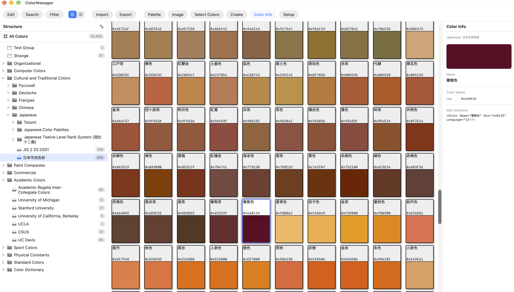
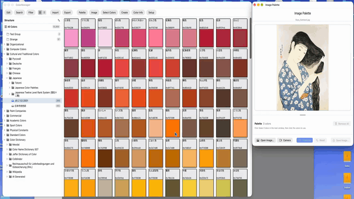

# Color Manager
Stuart Rankin\
March 2026

## Summary
Port (using both Claude and Gemini) of an iOS program I wrote, which in turn was ported from a Windows/WPF program I wrote that manages and displays colors. The colors are presented as a series of swatches in the view and can be sorted as desired.\
ColorManager also makes it easy to collect color names.

This image shows a general view of ColorManager's main window, showing a set of Japanese cultural colors. The overall structure of the color file is on the left.\


## Features
- **Browse** the color file as a tree of groups, with colors shown as swatches or as a list.
- **Search by name**, with `*` and `?` wildcards, alternative names, and character-set filters.
- **Search by color value** in RGB, Hex, HSB, or CMYK. Find the nearest colors within a tolerance, using either CIE76 or CIEDE2000 as the difference measure, or search HSB ranges. Double-click a result (macOS) to jump to that color in the main window.
- **Color-space conversion** between RGB, HSB, HSL, CMYK, XYZ, and Lab is built in and used by the search editors.
- **Select colors for a palette** with the Select Colors toolbar button. The selection stays in place as you move between groups.
- **Save a palette** in the same XML format as the main color list, under a file name you choose, or **add it to an existing color file**.
- **Palettize images and live video** with the selected colors (see below).
- **Remember the last color file** you loaded and reopen it at start-up (Setup button).

## Requirements and Building
ColorManager is a SwiftUI app for macOS and iOS. It targets macOS and iOS 26.2 or later, so it needs a version of Xcode that includes those SDKs, and a Metal-capable GPU for palettization. Live video palettization asks for camera permission the first time it is used.

### Note
This progam is intended to run on macOS but can function on iOS with some features removed.

### Building

To build, open `ColorManager.xcodeproj` in Xcode, choose the `ColorManager` scheme and a Mac or iOS destination, and run. The unit tests are in `ColorManagerTests` and run with Product > Test, or from the command line:

```
xcodebuild test -scheme ColorManager -destination 'platform=macOS'
```

## Palettization
Palettization is provided to test selecting various colors and seeing what they look like when applied to an image or video stream. Palettization uses a Metal kernel, but Core Image can probably be used as well. Each pixel is replaced with the closest color in the palette.

Open the dialog with the Image toolbar button. The palette is made of the colors you marked in the main window, shown in the dialog as small swatches that can be removed individually. The border between the image and the palette can be dragged to give either more room.
- **Images:** open an image from disk (on macOS you can also drag and drop one onto the dialog), press Palettize, and compare the result with the original. Reset discards the result and goes back to the original, and Save writes the palettized image as a PNG.
- **Live video:** the Camera button palettizes each frame from the camera as it arrives. Changing the palette while the camera runs takes effect immediately, Palettize live switches between the palettized and raw views, and Capture keeps the current frame so it can be saved.
- **Palettes:** the selected colors can be saved as their own color file, or added to an existing one, from the main toolbar.

The animation below shows the palettization of a single image using various colors, selected mostly at random from the set of available colors.\


The animation below is a screen capture of a video that is being palettized at runtime with selected colors.\


## Color File Structure
The set of colors resides in an XML file I wrote in 2008 and have modified ever since. At a high level, the structure is:
1. XML header
2. Version block which contains some structural data.
3. Set of **Color Groups**. A Color Group may contain child Color Groups to the limit of the system.

A Color Group usually serves as a hierarchical structure for a set of related colors. It also may contain language information, source links, short names, and class names (related to a C# implementation). Empty Color Groups are valid.

Each color is encapsulated in a **Color** structure. A color should contain a name and a color value (a color without a name is given a placeholder name when loaded). A color may contain multiple color values. If that is the case, the **Canonical** color space takes precedence; if none is given, the first one present is used, in the order Hex, RGB, HSL, HSB, CMYK, Lab. In the color collection file, duplicate colors are allowable. When read, the Color Manager will assign UUIDs to each color so duplicates never collide.

## A Typical Color
Here is a color from the file, shown inside its group (some attributes of the group are omitted):

```xml
<ColorGroup Name="Color Name Dictionary 507" Language="ja">
  <Color Name="桜色" Language="ja" Names="Cherry Pink" Tags="JIS"
         RGB="252,238,235" CMYK="0,7,3,0" Canonical="CMYK"/>
</ColorGroup>
```

The attributes are:
- **Name**: the color's primary name. Names can be in any language, here Japanese.
- **Language**: the language of the name (`ja` for Japanese).
- **Names**: alternative names, separated by commas. These are included when searching by name, so a search for "Cherry Pink" finds this color.
- **Tags**: free-form labels, separated by commas. Here the tag is `JIS`, for Japanese Industrial Standard.
- **RGB** and **CMYK**: the color's values. Colors may be given in `Hex`, `RGB`, `HSL`, `HSB`, `CMYK`, or `LAB`, and a color may give more than one. A color most often has just a name and a `Hex` value, such as `<Color Name="Red" Hex="ff0000"/>`.
- **Canonical**: which of the color's values is authoritative. Without it, the first value present is used in the order Hex, RGB, HSL, HSB, CMYK, Lab. Here, `Canonical="CMYK"` makes the CMYK value the authoritative one instead of the RGB value.

A color can also hold **Variant** children, which are alternate values of the same color. (A group may also contain a **Color Collection**, which holds colors the same way.)

```xml
<Color Name="Apple Green" Hex="8DB600">
  <Variant Hex="7E9F2E"/>
  <Variant Hex="44944A"/>
</Color>
```

When the file is read, every color is given a unique ID, so colors with the same name or value remain distinct.

## Copyright
The color data file carries this notice: Copyright (c) 2008 - 2026, Stuart Rankin. All rights reserved except for those trademarks specifically owned by others.
